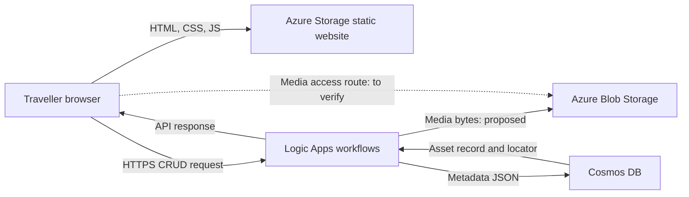
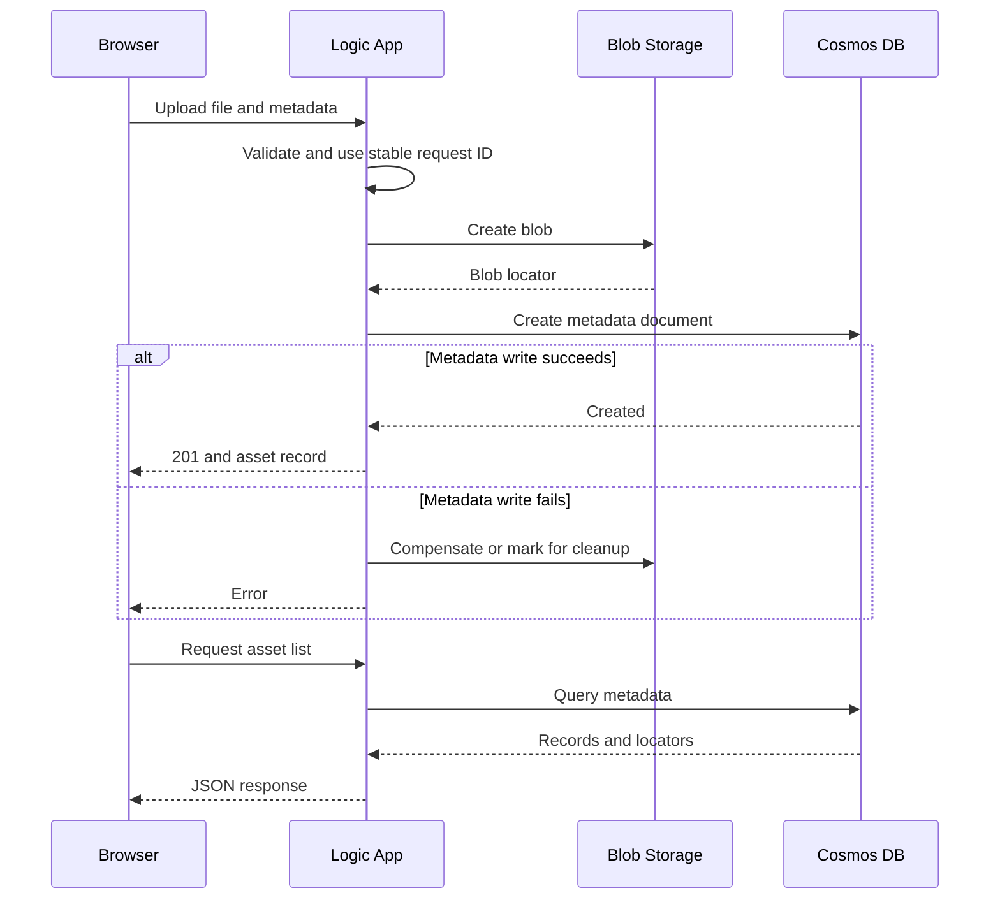
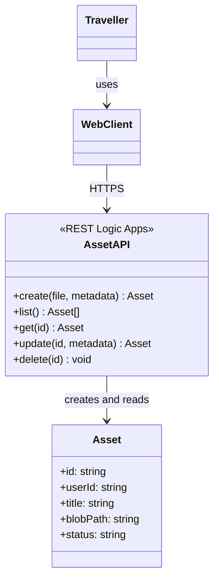
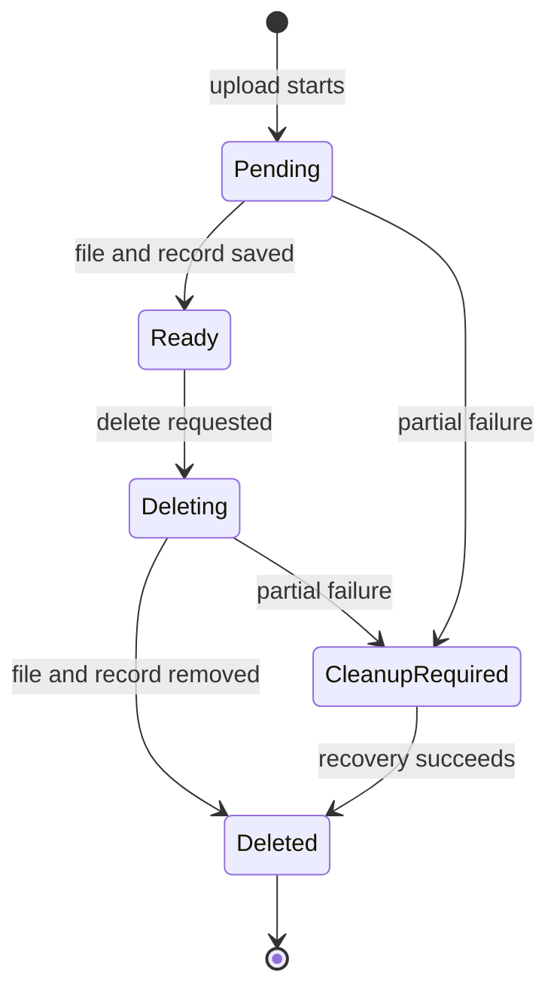
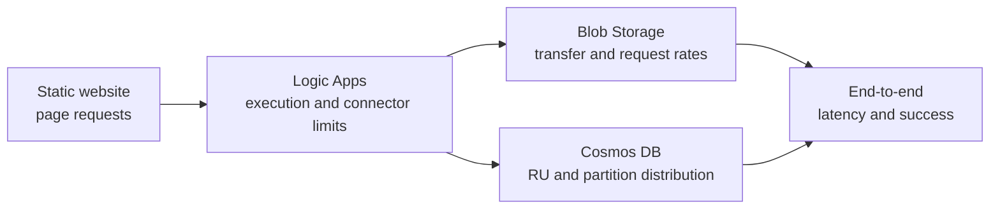

# Travel Journal Share CW1 最终逐页内容

本文件对应 COM682 Coursework 1。正文共 15 页，最后另加 1 页官方提交检查清单。幻灯片正文使用英文，中文说明只用于制作时参考，不放入最终 PPT。现有成果包括本地 CRUD 原型和已部署的 Azure Storage 静态网站；Logic Apps、Blob 媒体流程和 Cosmos DB 属于设计方案，不应写成已完成部署。

## 固定项目定义

- **Project:** Travel Journal Share
- **Media:** JPEG/PNG/WebP photographs and short MP4 videos
- **Audience:** independent travellers and small private travel communities
- **Driving constraint:** many members may upload media soon after a group trip, creating a short upload peak while stored media continues to grow
- **Azure pattern:** static website hosting + Logic Apps REST workflows + Blob Storage + Cosmos DB
- **Evidence boundary:** the static front end is deployed; the complete API and database integration is proposed for later implementation

> **课程材料核验：**附件包含正式作业说明、模块指南、旧版样例和讲解视频；没有独立的 Lab 1–6 操作指南或工作流定义。正式作业说明确认了实验对应关系，但没有提供文件传输细节。以下图中上传顺序、文件访问路径和视频支持均为设计假设，提交前应结合本人实验记录或课堂演示核对。若视频支持不能确认，提交版本应收窄为照片，不应声称视频已获实验验证。

## 精简版正文与技术图（优先用于制作 PPT）

下面的英文是压缩后的幻灯片正文；后续完整版本保留为论证和选材参考，不要将两版同时放进幻灯片。Mermaid 图可复制到支持 Mermaid 的编辑器，或按图在 PowerPoint 中重画；所有图均为设计，不代表完整云端部署。

### 1 Title

**Travel Journal Share**  
Cloud-native media sharing for small travel communities  
**[Name] | [Student number]**

### 2 Scenario and requirement

- Independent travellers share trip photographs; short video is subject to lab verification.
- After a group trip, many uploads may arrive together.
- Users create, browse, edit and delete media entries.
- Growing files and burst traffic drive the design. *(Ulster University, 2026)*

### 3 Technical problem

| Demand | Single-server pressure | Impact |
| --- | --- | --- |
| Upload peak | Network and disk contend | Delays or failures |
| Growing archive | Capacity and backups grow | More operational work |
| Concurrent browsing | Database reads compete with writes | API or database bottleneck |

Separate storage and processing responsibilities, then test the entire request path. *(Microsoft, n.d.-a)*

### 4 Service choices

| Service | Choice | Trade-off |
| --- | --- | --- |
| Static website | HTML/CSS/JS delivery | No server-side logic |
| Blob Storage | Binary media | Network and storage costs |
| Logic Apps | REST workflow orchestration | Connector and execution limits |
| Cosmos DB | Document metadata | Partition and query design matter |

Azure SQL offers enforced relationships and joins; Cosmos DB fits the proposed document-shaped asset. The choice depends on actual queries and lab configuration. *(Microsoft, 2026a; Microsoft, n.d.-b; Microsoft, n.d.-c)*

### 5 Webpage wireframe

```text
┌──────────────────────────────────────────────────────┐
│ TRAVEL JOURNAL SHARE                    Add a memory │
├──────────────────────────────────────────────────────┤
│ SHARE A MEMORY                                       │
│ Title        [________________________________]      │
│ Description  [________________________________]      │
│ Photo        [ Choose file ]    [ Publish ]          │
├──────────────────────────────────────────────────────┤
│ TRAVEL MEMORIES                            [Refresh] │
│ ┌───────────────┐   ┌───────────────┐                │
│ │ Media preview │   │ Media preview │                │
│ │ Title / text  │   │ Title / text  │                │
│ │ [Edit][Delete]│   │ [Edit][Delete]│                │
│ └───────────────┘   └───────────────┘                │
└──────────────────────────────────────────────────────┘
```

Static front end deployed; cloud API and database are proposed. Prototype limit: 10 MB per file. https://traveljournal.z1.web.core.windows.net/

### 6 Proposed architecture



Blob holds files; Cosmos DB holds metadata. Media access and authentication require verification. *(Microsoft, 2026a; Ulster University, 2026)*

### 7 Upload and read sequence



File delivery uses the access route permitted by the lab configuration; it is not established by the supplied brief. Retry and compensation require implementation and testing. *(Microsoft, 2026b)*

### 8 Data model

```json
{
  "id": "asset-001",
  "userId": "user-001",
  "journalId": "trip-001",
  "title": "Mountain walk",
  "description": "Morning route",
  "mediaType": "image/jpeg",
  "blobPath": "media/asset-001",
  "status": "ready",
  "uploadedAt": "2026-11-01T10:00:00Z"
}
```

Candidate partition key `/userId`: supports per-user reads but a community feed may span partitions. A user ID alone does not authenticate ownership. *(Microsoft, n.d.-c; Microsoft, n.d.-d)*

### 9 REST API UML



| Action | Logical HTTP operation | Lab link |
| --- | --- | --- |
| Create | `POST /assets` | IUPS pattern |
| List / detail | `GET /assets`, `GET /assets/{id}` | RAI extended |
| Edit / delete | `PUT /assets/{id}`, `DELETE /assets/{id}` | CRUD extensions |

These are conceptual paths; actual Logic App callback URLs may differ. *(Ulster University, 2026)*

### 10 Integration and lifecycle



The same asset ID links Blob and metadata. The client supplies a stable request ID across retries, or the server persists the ID before work starts; uniqueness and duplicate handling must be implemented. Cleanup adds workflow complexity. This lifecycle is proposed, not implemented. *(Microsoft, 2026b)*

### 11 Limitations and trade-offs

| Risk | Impact | Response / cost |
| --- | --- | --- |
| No verified user authentication | Unauthorised access or editing | Add identity and authorisation; more complexity |
| Partial upload or delete | Orphan file or invalid record | Retry and compensate; more workflow state |
| Large or unsafe files | Cost and harmful content | Validate and moderate; potential user friction |
| Traffic spike | Throttling or failure | Backoff and capacity tuning; higher cost |

Private community sharing is a goal; it is not secured by the current prototype. *(Microsoft, 2026b; Microsoft, n.d.-b)*

### 12 Scalability evaluation



- Each service addresses a different part of growth; a bottleneck in any stage affects the whole upload.
- Test concurrent users and file sizes; measure success, p95 latency, throttling, RU consumption and cost.
- These are proposed tests, not measured results. *(Microsoft, n.d.-a; Microsoft, n.d.-b; Microsoft, n.d.-c)*

### 13 Conclusion and ethics

- The proposed pattern separates static delivery, workflows, media and metadata for a small travel community.
- Priorities: verify lab flow, add authorised access, then test recovery and peak load.
- A travel club could share trip journals; retention and running costs affect its business case.
- Obtain sharing permission and minimise identifiable people and location metadata. *(ICO, n.d.; ICO, 2025; UK Intellectual Property Office, 2021)*

### 14–15 References

Use the full reference list below. Keep each source cited on its relevant content slide; replace the unverified generic Labs citation with the actual source only if available. The module guide itself supports the stated lab mapping.

### 16 Official submission checklist

Use the checklist in the full section below. Check each box only after personally verifying the finished PowerPoint.

---

---

## Slide 1 — Travel Journal Share

### 放在幻灯片上的英文

**Travel Journal Share**

Cloud-native photo and short-video sharing for independent travellers and small travel communities.

**[Student name] — [Student number]**

### 视觉与排版

使用旅行照片作大幅背景或左侧主图，标题保持简洁。不要在封面写技术栈或长段说明。

---

## Slide 2 — Use case and design requirements

### 放在幻灯片上的英文

**Users and core journey**

- Travellers create a media entry, upload a photograph or short video, browse the community feed, edit the description and delete their own entry.
- Media files and descriptive metadata must remain linked throughout the asset lifecycle.

**Driving constraint**

- A group trip can produce a concentrated upload peak immediately after the event.
- Video files increase network transfer and storage demand, while the media collection grows over time.

**Design scope**

- The design adapts the Labs 1–6 pattern. It does not assume authentication, moderation or video processing that the labs did not implement.

底部小字引用：**(Ulster University, 2026)**

### 视觉与排版

画一个简单场景：旅行结束 → 多名成员集中上传 → 社群浏览。用旁注区分“design assumption”和“lab-supported scope”。

---

## Slide 3 — Technical problem and non-cloud pressure

### 放在幻灯片上的英文

| Demand | Pressure on a traditional single-server design | Consequence |
| --- | --- | --- |
| Concurrent uploads | Web processing, network transfer and disk writes compete on one host | Higher latency or failed requests during peaks |
| Larger video files | Capacity and bandwidth must be planned before demand is known | Over-provisioning when idle or insufficient capacity at peak |
| Growing archive | Files, backups and metadata consume local storage | Manual expansion and longer recovery operations |
| Feed browsing after upload | Database reads rise while uploads continue | File storage alone cannot remove the API or database bottleneck |

**Critical point:** separating the front end, workflow, file store and metadata store lets each responsibility grow independently, but the end-to-end service remains limited by its slowest stage.

底部小字引用：**(Microsoft, n.d.-a; Ulster University, 2026)**

### 视觉与排版

用“demand → affected resource → impact”的横向表。不要声称传统服务器一定失败；使用“may”, “can”或“depends on workload”。

---

## Slide 4 — Azure service selection and alternatives

### 放在幻灯片上的英文

| Requirement | Selected service | Reason and trade-off |
| --- | --- | --- |
| Deliver HTML, CSS and JavaScript | Azure Storage static website | Simple static hosting already demonstrated; it provides no server-side application logic or built-in authentication |
| Store photographs and videos | Azure Blob Storage | Keeps large binary objects outside the metadata database; performance still depends on object size, naming and access pattern |
| Expose CRUD operations | Logic Apps Consumption workflows | Managed, pay-per-execution orchestration matches the Lab 6 IUPS/RAI pattern; connectors and workflow limits remain relevant |
| Store asset metadata | Azure Cosmos DB for NoSQL | JSON documents fit variable media metadata and partition horizontally; partition-key choice affects query cost and load distribution |

**Alternative considered:** Azure SQL provides strong relational constraints and familiar joins, but the current asset record is document-shaped and the Lab 6 document pattern requires less schema translation. SQL would become more attractive if journals, users, permissions and reporting required many enforced relationships.

底部小字引用：**(Microsoft, 2026a; Microsoft, n.d.-b; Microsoft, n.d.-c)**

### 视觉与排版

用四个 Azure 图标和一张窄表。明确比较 Cosmos DB 与 Azure SQL，但最终架构只保留 Cosmos DB。

---

## Slide 5 — Webpage wireframe and prototype evidence

### 放在幻灯片上的英文

**Interface structure**

1. Header and short explanation
2. Upload form: title, description and media file
3. Responsive media feed
4. Edit and delete actions on each asset

**Traceability to the API**

- Publish → `POST /assets`
- Refresh feed → `GET /assets`
- Edit metadata → `PUT /assets/{id}`
- Delete asset → `DELETE /assets/{id}`

**Evidence statement:** A static front-end prototype is deployed on Azure Storage. Its current 10 MB client-side limit is a prototype rule, not a claimed Azure platform limit. The cloud API and database remain design work for later implementation.

### 视觉与排版

左侧放线框图，右侧放实际网页截图及公开网址：

`https://traveljournal.z1.web.core.windows.net/`

截图应显示页头、上传表单和媒体列表区域；不要展示账户、订阅 ID 或个人邮箱。

---

## Slide 6 — Proposed Azure solution architecture

### 放在幻灯片上的英文

```text
Traveller browser
  ├─ GET HTML/CSS/JS ───────────────► Azure Storage static website
  ├─ HTTPS CRUD requests ───────────► Logic Apps REST workflows
  │                                      ├─ file bytes ─────► Blob Storage
  │                                      └─ metadata ───────► Cosmos DB
  └─ media request ◄──────────────── returned file locator / Lab 6 access route
```

**Responsibility split**

- Static hosting serves the interface.
- Logic Apps validates requests and coordinates operations.
- Blob Storage holds media bytes.
- Cosmos DB holds searchable metadata and lifecycle state.

**Scope boundary:** the final media-access route and permissions must follow the Lab 6 implementation. A stored `userId` does not authenticate a user.

底部小字引用：**(Microsoft, 2026a; Ulster University, 2026)**

### 视觉与排版

改画成 Azure 架构图，必须标出两种数据流：橙色为 media bytes，蓝色为 JSON metadata。只使用课程允许的四类 Azure 资源，不加入 Functions、Event Grid、Front Door、Entra ID 或 AI Search。

---

## Slide 7 — Upload and retrieval control flow

### 放在幻灯片上的英文

**Upload**

1. Browser sends the file and required metadata to the upload workflow.
2. Logic App validates required fields, media type and the configured size rule.
3. Workflow creates the Blob using a unique asset identifier.
4. Workflow writes a Cosmos DB document with `status: ready` and the Blob locator.
5. API returns the created record to the browser.

**Retrieve all**

1. Browser calls the RAI-style workflow.
2. Logic App queries asset documents and returns JSON metadata.
3. Browser renders the feed and retrieves media through the Lab 6 access route.

**Partial failure:** if the Blob succeeds but the document write fails, retry with the same asset ID; if recovery fails, delete the orphan Blob or record it for cleanup. The steps are not one atomic cross-service transaction.

底部小字引用：**(Microsoft, 2026b)**

### 视觉与排版

使用四泳道顺序图：Browser、Logic App、Blob、Cosmos DB。成功路径用实线，补偿/清理路径用红色虚线。

---

## Slide 8 — Cosmos DB document design

### 放在幻灯片上的英文

```json
{
  "id": "asset-8f14...",
  "userId": "user-001",
  "journalId": "trip-2026-01",
  "title": "Mountain walk",
  "description": "Morning route above the valley",
  "mediaType": "image/jpeg",
  "fileName": "mountain.jpg",
  "blobPath": "media/asset-8f14...",
  "status": "ready",
  "uploadedAt": "2026-11-01T10:00:00Z"
}
```

**Partition key: `/userId`**

- Supports ownership checks and efficient per-user retrieval when the ID and partition key are known.
- A community-wide feed may require a cross-partition query, increasing RU consumption.
- The choice should be validated with expected user distribution and query frequency; a low-cardinality key could create a hot partition.

**File bytes remain in Blob Storage.** The document stores the locator and lifecycle state only.

底部小字引用：**(Microsoft, n.d.-c; Microsoft, n.d.-d)**

### 视觉与排版

左侧放 JSON，右侧放字段职责和分区键取舍。不要把示例 ID 或日期说成真实用户数据。

---

## Slide 9 — Logic Apps REST API design

### 放在幻灯片上的英文

| Operation | Conceptual endpoint | Input | Success response |
| --- | --- | --- | --- |
| Create asset | `POST /assets` | File + metadata | `201 Created` + asset document |
| Retrieve all | `GET /assets` | Optional filter/paging values | `200 OK` + asset array |
| Retrieve one | `GET /assets/{id}` | Asset ID | `200 OK` or `404 Not Found` |
| Update metadata | `PUT /assets/{id}` | Title and description | `200 OK` + updated document |
| Delete asset | `DELETE /assets/{id}` | Asset ID | `200/204` or `404 Not Found` |

```text
Traveller ──uses──► Static Web Client ──calls──► «REST API» Asset Workflows
                                                   ├─ IUPS / Create
                                                   ├─ RAI / Retrieve all
                                                   ├─ Retrieve one
                                                   ├─ Update metadata
                                                   └─ Delete asset
```

**Design note:** the URI paths express the logical API. In Logic Apps, each HTTP-triggered workflow may expose its own callback URL. The final mapping must follow the Lab 6 pattern.

底部小字引用：**(Ulster University, 2026; Microsoft, n.d.-b)**

### 视觉与排版

主视觉用 UML component/use-case 风格图，右下角保留小型端点表。更新只修改元数据，避免模糊“替换文件”的含义。

---

## Slide 10 — Integration decisions and alternatives

### 放在幻灯片上的英文

**One identifier links the workflow**

- The API generates an asset ID and uses it in both the Blob name and Cosmos document.
- This supports idempotent retries and makes orphan detection practical.

**Files and metadata use different stores**

- Blob Storage handles binary payloads; Cosmos DB handles searchable records.
- The separation reduces database payload size but introduces eventual-consistency and cleanup work.

**Read and write paths have different pressure**

- Uploads stress file transfer and database writes.
- Feed browsing stresses metadata queries and media downloads.
- Monitoring must therefore evaluate the whole path rather than one service in isolation.

**Transferability:** the pattern could support event photography or wildlife reporting, but the schema, retention period, access policy and accepted file types would need to change.

底部小字引用：**(Microsoft, 2026b; Microsoft, n.d.-a)**

### 视觉与排版

画一条 asset lifecycle：`pending → ready → deleting → deleted/cleanup-required`。旁边用一小块对比说明“separation benefit / consistency cost”。

---

## Slide 11 — Limitations and mitigations

### 放在幻灯片上的英文

| Limitation | Consequence | Mitigation and trade-off |
| --- | --- | --- |
| Authentication and authorisation are outside the demonstrated design | A public endpoint could expose or modify media without proving ownership | Add identity and least-privilege access in a future iteration; this adds setup complexity and may affect the simple static-client flow |
| Blob and Cosmos operations are not one transaction | Orphan files or broken locators can remain after partial failure | Use deterministic IDs, retry-safe steps, lifecycle status and scheduled/manual cleanup; compensation adds workflow logic |
| Large or malicious uploads | Higher transfer/storage cost and potential unsafe content | Enforce verified file type and size rules, moderation and malware scanning later; stricter controls can reject legitimate media |
| Consumption services have quotas and connector limits | Peak requests can throttle or fail | Measure workload, use backoff and tune capacity/workflow settings; higher capacity increases cost |
| A public static prototype has no private community boundary | Travel location and identifiable people may be exposed | Treat public hosting as prototype evidence only and define privacy controls before real use |

底部小字引用：**(Microsoft, 2026b; Microsoft, n.d.-b; ICO, n.d.)**

### 视觉与排版

用三列风险表，每一项都必须包含后果、缓解和缓解代价。身份控制只能标为未来改进，不能画进当前 Labs 1–6 架构。

---

## Slide 12 — Scalability evaluation

### 放在幻灯片上的英文

| Component | How it supports growth | Remaining bottleneck / evidence needed |
| --- | --- | --- |
| Static website | Static files are served independently from API processing | Media and API latency remain separate concerns; static hosting has no application logic |
| Logic Apps Consumption | Managed pay-per-execution workflows avoid pre-provisioning a web server | Execution, payload and connector limits can throttle the chain; verify with concurrent requests |
| Blob Storage | Managed partitioning supports large object collections | Object size, naming and access pattern affect throughput; hot partitions and throttling remain possible |
| Cosmos DB | Partitioning distributes storage and RU demand | Poor partition-key distribution or cross-partition feed queries can raise latency and RU consumption |

**System-level conclusion:** the design can scale individual responsibilities, but it does not provide unlimited capacity. End-to-end performance depends on uploads, Logic App execution, Blob writes, Cosmos writes and later media downloads all completing successfully.

**Validation plan:** vary concurrent users and file sizes; record success rate, p95 latency, Logic App failures, Blob throttling, Cosmos RU consumption and estimated cost. These are proposed measurements, not existing results.

底部小字引用：**(Microsoft, n.d.-a; Microsoft, n.d.-b; Microsoft, n.d.-c; Microsoft, n.d.-d)**

### 视觉与排版

用四组件横向链路，上方标“growth mechanism”，下方标“bottleneck”。突出“proposed test metrics”，避免编造性能数字。

---

## Slide 13 — Conclusion, commercial value and ethics

### 放在幻灯片上的英文

**Conclusion**

- The Labs 1–6 pattern fits the selected use case because static delivery, workflow orchestration, binary storage and metadata querying have separate responsibilities.
- The design addresses short upload peaks more flexibly than a single pre-sized server, but its success depends on verified file constraints, partitioning and failure recovery.

**Priority improvements**

1. Add authenticated ownership and private sharing.
2. Implement idempotent upload/delete compensation and cleanup.
3. Run the proposed load and cost tests before expanding beyond a small community.

**Commercial and ethical position**

- A travel club or small tour operator could use the platform to share trip media and branded journals.
- Photographs may identify people, and EXIF metadata can reveal location. Users need clear sharing choices, retention/deletion processes and data minimisation.
- Uploaders must hold permission or an appropriate licence for photographs and videos shared online.

底部小字引用：**(ICO, n.d.; ICO, 2025; UK Intellectual Property Office, 2021)**

### 视觉与排版

左侧结论与改进优先级，右侧隐私和版权图标。不要声称方案已解决身份、隐私或版权问题。

---

## Slide 14 — References 1

### 放在幻灯片上的英文

Harvard 格式，建议字号 17–18 pt，使用悬挂缩进。

Microsoft (2026a) ‘Static website hosting in Azure Storage’. Available at: https://learn.microsoft.com/en-us/azure/storage/blobs/storage-blob-static-website (Accessed: 29 October 2026).

Microsoft (2026b) ‘Compensating Transaction pattern’. Available at: https://learn.microsoft.com/en-us/azure/architecture/patterns/compensating-transaction (Accessed: 29 October 2026).

Microsoft (n.d.-a) ‘Scalability and performance targets for Blob storage’. Available at: https://learn.microsoft.com/en-us/azure/storage/blobs/scalability-targets (Accessed: 29 October 2026).

Microsoft (n.d.-b) ‘Limits and configuration reference for Azure Logic Apps’. Available at: https://learn.microsoft.com/en-us/azure/logic-apps/logic-apps-limits-and-config (Accessed: 29 October 2026).

Microsoft (n.d.-c) ‘Partitioning and horizontal scaling in Azure Cosmos DB’. Available at: https://learn.microsoft.com/en-us/azure/cosmos-db/partitioning (Accessed: 29 October 2026).

---

## Slide 15 — References 2

### 放在幻灯片上的英文

Microsoft (n.d.-d) ‘Request Units in Azure Cosmos DB’. Available at: https://learn.microsoft.com/en-us/cosmos-db/request-units (Accessed: 29 October 2026).

Information Commissioner’s Office (ICO) (n.d.) ‘What is personal data?’. Available at: https://ico.org.uk/for-organisations/uk-gdpr-guidance-and-resources/personal-information-what-is-it/what-is-personal-data/what-is-personal-data/ (Accessed: 29 October 2026).

Information Commissioner’s Office (ICO) (2025) ‘Disclosing documents to the public securely: hidden personal information and how to avoid an accidental disclosure’. Available at: https://ico.org.uk/media2/pbwchh24/disclosing-documents-to-the-public-securely-all-1-0-0.pdf (Accessed: 29 October 2026).

UK Intellectual Property Office (2021) ‘Copyright notice: digital images, photographs and the internet’. Available at: https://www.gov.uk/government/publications/copyright-notice-digital-images-photographs-and-the-internet/copyright-notice-digital-images-photographs-and-the-internet (Accessed: 29 October 2026).

Ulster University (2026) *COM682 Cloud Native Development Module Guide 2026/27*. Internal module material.

课程实验的独立文献条目暂不列入：附件中没有 Lab 1–6 原始讲义，无法核实具体标题和作者。现有课程映射引用上面的模块指南；如本人有实验记录，可按学校格式补充准确来源。

---

## Slide 16 — Submission checklist

此页不计入 15 页，但必须作为最后一页。使用勾选框逐项确认。

### 放在幻灯片上的英文

**General**

- [ ] Title slide includes project name, one-line use case, name and student number.
- [ ] File is a PowerPoint deck with no more than 15 assessed slides.

**Problem and context**

- [ ] The cloud rationale, target audience and driving constraint are explicit.
- [ ] Scalability issues affecting the project resources are discussed.

**Solution design — Labs 1–6 only**

- [ ] Architecture uses only resources and patterns covered in Labs 1–6.
- [ ] Webpage wireframe is included.
- [ ] Database schema matches the Lab 6 metadata pattern.
- [ ] CRUD REST API is shown as UML and linked to IUPS/RAI.
- [ ] Static front end, REST workflows, Blob and database integration are shown.

**Critical evaluation**

- [ ] Limitations include remedies and trade-offs.
- [ ] Scalability evaluates the combined behaviour of all components.
- [ ] Service choices are justified against alternatives.

**Conclusion and references**

- [ ] Conclusion covers improvements, commercial value and ethics.
- [ ] All technical claims have matching Harvard references.

---

## 制作时必须遵守的证据边界

- 可以写：静态网页已部署到 Azure Storage，公开终结点可以访问。
- 可以写：本地原型演示了创建、列表、编辑和删除的用户流程。
- 不可以写：Logic Apps、Cosmos DB、身份验证或完整上传链路已经部署或测试。
- 不可以把本地 10 MB 限制写成 Azure 平台限制。
- 不可以使用旧 Sample CW1 中的 Functions、Event Grid、Front Door、Entra ID、AI Search 等资源作为本方案现有组件。
- 若 Lab 6 的文件传输方向、端点命名或访问方式与本稿不同，以 Lab 6 为准，并同步修改 Slide 6、7、9。

## 提交前仍需补充

1. 姓名和学号。
2. Labs 1–6 的实际标题、IUPS/RAI 截图或课堂定义。
3. 一张不含账户信息的 Azure 静态网站截图。
4. 学校要求的生成式 AI 使用说明；按模块或学校指定格式填写。
