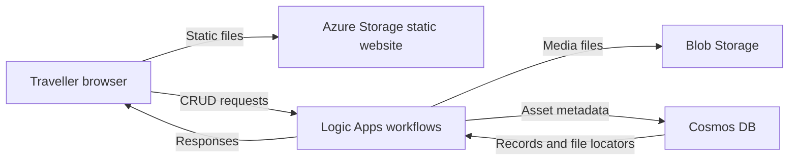

# Travel Journal Share

A cloud-native multimedia sharing design for independent travellers and small travel communities, prepared for COM682 Coursework 1. The scenario assumes that members upload photographs after a trip, creating short peaks in traffic and a growing media archive.

This repository contains the design, a PowerPoint content draft and a local functional prototype. CW1 focuses on design and evaluation; the complete Azure application is not deployed.

## Current status

- **Azure static front end:** [Travel Journal Share](https://traveljournal.z1.web.core.windows.net/). The HTML, CSS and JavaScript are hosted on Azure Storage.
- **Local prototype:** supports creating, listing, editing and deleting media entries using a Python server, SQLite and local files.
- **Proposed cloud design:** Azure Storage static website, Logic Apps REST workflows, Blob Storage and Cosmos DB. The API and database have not been deployed or integrated.
- **Coursework material:** the slide content and diagrams are in [PPT逐页内容草稿.md](PPT逐页内容草稿.md). The actual PowerPoint has not yet been created.

The deployed static site currently has no connected API, so its upload and media-list features do not work online. The local server provides those features for demonstration.

## Proposed architecture



This diagram describes a proposal. The exact upload and media access paths must be checked against the Lab 6 pattern. Authentication and authorisation are not implemented. The repository includes a fuller sequence diagram, API UML and scalability analysis in the slide draft.

## Run the local prototype

Requirements: Python 3.9 or later. No additional packages are required.

```powershell
cd prototype
python server.py
```

Open <http://127.0.0.1:8000/>. Stop the server with `Ctrl+C`. Local metadata and uploaded files are stored under `prototype/data/`.

The prototype accepts JPEG, PNG, WebP and MP4 files up to 10 MB. These are prototype rules, not verified Azure or course-lab limits. Video support in the final coursework design remains subject to lab verification. The local prototype has no login, access control or content scanning and is intended only for local demonstration.

## Local API

| Method | Path | Purpose |
| --- | --- | --- |
| POST | `/api/assets` | Create an asset from metadata and Base64 file content |
| GET | `/api/assets` | List assets |
| GET | `/api/assets/{id}` | Retrieve one asset |
| PUT | `/api/assets/{id}` | Update title and description |
| DELETE | `/api/assets/{id}` | Delete the record and its local file |
| GET | `/media/{id}` | Retrieve the local media file |

See [prototype/README.md](prototype/README.md) for request fields and implementation boundaries. The proposed Logic Apps endpoints are conceptual and may use different callback URLs.

## Repository contents

| Path | Contents |
| --- | --- |
| [CW1旅行博客平台规划.md](CW1旅行博客平台规划.md) | Coursework plan and assessment mapping |
| [PPT逐页内容草稿.md](PPT逐页内容草稿.md) | Condensed slide text, technical diagrams, references and checklist |
| [prototype/](prototype/) | Local Python server and static front end |
| `附件/` | Course brief, module guide, explanation video and older sample |

## Remaining coursework work

Create the PowerPoint with no more than 15 assessed slides and a separate final checklist slide. Add the student's name and number, verify the final diagrams and file types against the actual lab experience, check citations and follow the university's AI acknowledgement requirements. The supplied course brief describes the lab mapping but does not include the detailed Lab 6 workflow.

Before publishing this repository, review the course attachments for permission to redistribute them and check that no personal information, credentials or uploaded media are included. No licence has been specified for this repository.
